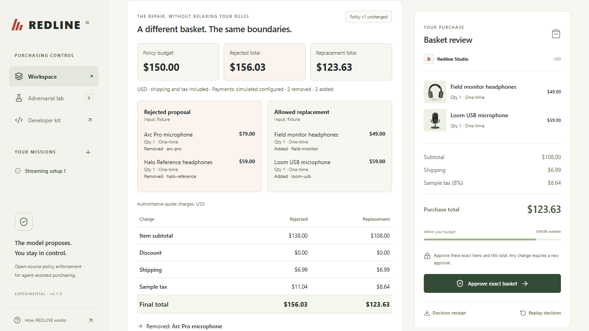

# REDLINE

**Give agents a mission. Keep control of the money.**

An experimental open-source TypeScript policy SDK and a complete local purchasing reference application. A model proposes products; deterministic code checks the confirmed policy and server-side catalogue; an authenticated user approves the exact basket; PayPal supplies sandbox payment evidence. One merchant, USD, one-time purchases only.



## Run locally

Requirements: Node **22.16–24.x**, npm **10+**, Docker Compose, available ports 3000 and 54329. The lockfile pins the tested dependency graph. PowerShell users should use `npm.cmd` if script execution policy blocks `npm.ps1`; the commands below otherwise work with `npm`.

For judge/public-repository setup, clone the actual authorized repository URL at the submission manifest's source commit, enter its checkout directory, then run the commands below. Credentials are deliberately absent from the repository. Follow [the real-workflow access path](docs/ACCESS_CONTINUITY.md) to configure an approved model and your authorized PayPal sandbox accounts; defaults alone demonstrate fixtures/simulation only.

```sh
npm ci
docker compose up -d db
# PowerShell: Copy-Item .env.example .env
# macOS/Linux: cp .env.example .env
npm run db:migrate
npm run db:seed
npm run dev
```

Open **http://localhost:3000** and select **Enter local workspace**. Defaults are explicitly **fixture proposals** and **simulated payments**. No credentials or network services are needed beyond local PostgreSQL for this mode. A simulated completion is never a PayPal sandbox transaction.

Confirm the mission's editable rules, generate the first fixture proposal (blocked at $156.03), inspect its decision, find the $123.63 alternative, approve its exact basket, create a simulated order, simulate buyer approval, verify/capture, download the receipt and replay it. The real agent can also be run once approved access is configured. You can select catalogue products manually; these are labeled scripted proposals.

The repair panel shows the rejected and replacement baskets side by side, including additions/removals, quantities, all charges, resolved constraints and required categories. The confirmed policy stays fixed through repair. **Edit confirmed policy** is an explicit user action: it creates a new version, invalidates old approvals and preserves cumulative spending. Resolve pending payments before editing. Price/term changes return a structured old/current comparison; stale tabs cannot approve an outdated snapshot. No mission is forced to succeed.

`npm run dev` reads the root `.env` through Next's configured environment loader. CLI commands use `dotenv/config`. No `.env` is required for the safe defaults. Never put private values into `NEXT_PUBLIC_*` variables.

## Real adapters and verification status

The OpenAI-compatible structured action adapter and PayPal sandbox OAuth/create/redirect approval/capture/retrieve/webhook adapters are implemented. **No live model or PayPal sandbox credentials were supplied during implementation. Live inference, sandbox authentication/order creation/buyer approval/capture, and real webhook delivery are NOT verified.** The submission must not represent fixture results as live evidence. See [verification](docs/VERIFICATION.md) and [integration setup](docs/INTEGRATIONS.md).

`npm run verify:live` reports only configured checks: one approved structured model request and PayPal authentication. Missing settings, invalid configuration or failed checks return a nonzero exit code and a redacted report in `.local/verification-latest.json`. Even `preflightPassed: true` is only an access smoke check; `journey: not_verified` remains until you verify checkout in the browser. It does not silently switch modes, select a paid model, create a payment, capture, or configure a public webhook. To verify the real checkout vertical slice, set sandbox credentials and `PAYMENT_MODE=sandbox`, restart, and use the authenticated browser journey. Save its actual redacted receipt.

The [submission review](docs/SUBMISSION_REVIEW.md) separates real PostgreSQL/server checks from model/PayPal HTTP fixtures, lists the exact manual access steps and explains the deferred regression export. After dependency installation, `npm run verify:package` reproduces the seeded $156.03 rejection offline without model, PayPal or database access; it is an existing SDK example, not an exported receipt fixture.

## Checks

Create a dedicated test database once (never use the application database):

```sh
docker compose exec -T db createdb -U redline redline_test
npm run typecheck
npm run lint
npm test
npm run test:integration
npm run test:browser
npm run verify:package
npm run build
```

Integration tests use real PostgreSQL and a durable payment test double. They truncate only a dedicated database with an `_test` name. Override `TEST_DATABASE_URL` to another dedicated database if necessary. Browser tests start their own fixture server on port 3001 and test desktop and mobile layouts. On Windows they use installed Microsoft Edge; on Linux run `npx playwright install --with-deps chromium` first. `PLAYWRIGHT_CHANNEL` can select another installed channel. Do not run the integration truncation suite concurrently with browser tests.

For the optimized local application: `npm run build`, then `npm run start -w @redline/web`. Keep development shortcuts restricted to loopback. Production mode in Next does not imply production payments: the only supported payment network is PayPal sandbox.

## Repository

| Path | Purpose |
| --- | --- |
| `packages/policy` | Dependency-free evaluator, exact money, hashes, public exports, declarations |
| `packages/paypal` | Server-only sandbox REST adapter and provider evidence validation |
| `apps/web` | Next.js/React/Tailwind workspace, catalogue, sessions and orchestration |
| `migrations` | Committed Kysely migrations; persistent constraints and state |
| `scripts` | Seed, migrate, bounded reconciliation batch, live checks and package verification |
| `examples/consumer` | Offline SDK consumer using only the packed public package |
| `examples/host-integration.ts` | Complete host contract using the existing protected services; exercised against PostgreSQL in integration tests |
| `tests` | Vitest policy/provider/agent tests, PostgreSQL concurrency tests, Playwright workflows |
| `docs` | Architecture, state machine, threat model, setup, operations and hackathon materials |

## Guarantees and limits

Validated snapshots use bounded integer money, exact charges and server prices. Approvals bind policy/quote hashes, owner, mission, operation, payee, currency, complete items and expiry. Mission and operation locks atomically reserve cumulative budget, purchase count and stock; network calls happen after commit. One local operation can settle only once. Ambiguous operations retain capacity. Completed state cannot be downgraded by delayed notifications. Real webhooks must verify through PayPal and trigger an authoritative order retrieval.

These properties assume all payments use this server path, PostgreSQL durability/constraints remain intact, secrets and merchant configuration are trusted, and no external administrator captures orders independently. They are **not a universal exactly-once payment guarantee**. Unknown creates without an order ID and unresolved capture outcomes require operator reconciliation. Provider request-ID retention is not specified by the current endpoint documents; this version does **not automatically retry payment mutations**. It retrieves known orders instead. No fulfillment, refunds, disputes, real taxes, subscriptions, arbitrary retailer browsing, or live-money mode is implemented.

The reference login is for local development. A remote deployment must disable `DEV_LOGIN` and `LOCAL_LAB`, configure a trusted identity gateway, use HTTPS and keep the origin inaccessible directly. See [threat model and readiness gaps](docs/THREAT_MODEL.md), [architecture](docs/ARCHITECTURE.md), [state and recovery](docs/STATE_MACHINE.md), [operations and deployment](docs/OPERATIONS.md).

MIT license. Experimental API. Contributions: [CONTRIBUTING.md](CONTRIBUTING.md). No packages, repository, application or hackathon submission were published by this implementation.

Submission preparation: [access continuity through the announcement](docs/ACCESS_CONTINUITY.md), [2:40 video script](docs/DEMO_SCRIPT.md), [freeze/preservation procedure](docs/SUBMISSION_FREEZE.md). After committing a reviewed clean tree, `npm run submission:manifest` records its source commit, lockfile hash, package versions and external configuration names without values. It creates a local candidate record only; it does not publish, submit or freeze external materials.
